 
i like building things that actually run. Mostly python and react, lately a lot of agentic stuff and security tooling.
 
final year at GHRCEM, nagpur. Currently learning c++ and dsa, and getting into competitive programming (slowly, painfully).

let's connect:  
[github](https://github.com/darshansahare) &nbsp;·&nbsp; [linkedin](https://www.linkedin.com/in/darshansahare/) &nbsp;·&nbsp; [discord](https://discord.com/users/1299614021946703882)

### Stuff i've built
 
**ZeroDay** — red-team and blue-team LLMs that reproduce a vulnerability, then patch it and check the patch actually works. Made for the Nebius × NVIDIA hackathon.
 python · fastapi · react
 
**NEXUS** — a personal productivity agent on MCP. emini up front, llama on groq as backup, with whatsapp reminders, undo, and a human-in-the-loop step before it does anything risky.
 fastmcp · sqlite · streamlit
 
**DevInsights** — paste a github repo, get charts and a pdf report.
 react · vite · recharts

### Open-source
 
merged PRs in **PetSathi** and **Pinfold**. I also review other people's PRs, which turns out to be half the fun.
 
### Stack
 
python &nbsp;·&nbsp; javascript &nbsp;·&nbsp; react &nbsp;·&nbsp; vite &nbsp;·&nbsp; fastapi &nbsp;·&nbsp; c++ &nbsp;·&nbsp; mcp &nbsp;·&nbsp; llm apis &nbsp;·&nbsp; sqlite
 
### The numbers
 

 

 
